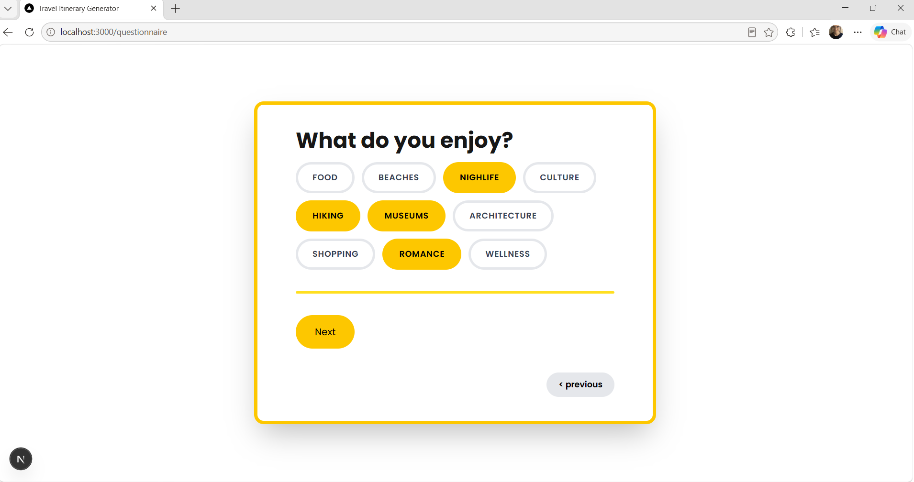
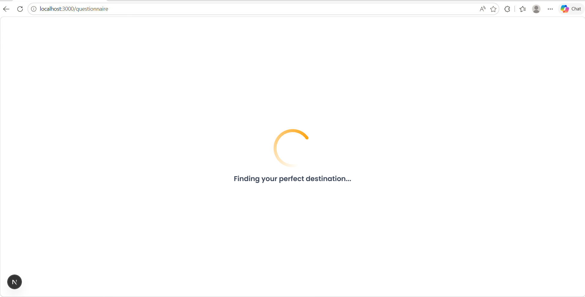
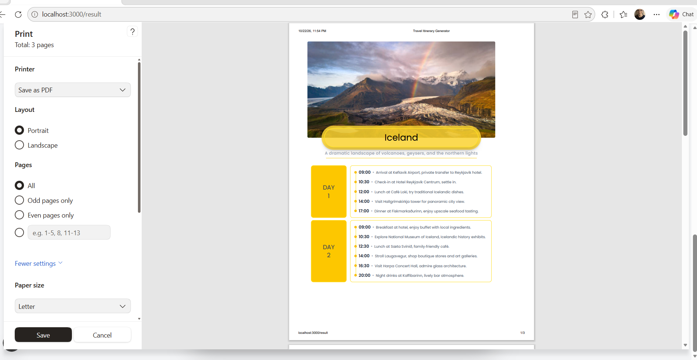

This is a full-stack web application built with [Next.js](https://nextjs.org). The application lets user enter information in questionnaire page, resulting in showing the ideal destination and itinerary generated by LLM.

## Live demo link

[https://travel-itinerary-beta-one.vercel.app/]

## Screenshots

-landing page - basic, simple style.

- Example of one question in the questionnaire (UI look)

- UI of loading page

- Result page (The final recommendation generated by the scoring algorithm)
.png)
- PDF Export



## Tech stack
- Next.js
    - full-stack framework handling both frontend and backend
- TypeScript 
- Tailwind CSS
- PostGreSQL
    - via Prisma/Supabase
- Groq SDK & LLM(openai/gpt-oss-120b)
- Leaflet 
    - for interaction maps

 ## Architecture
The core of this app is built on a custom scoring algorithm that matches user preferences to destinations stored in the database. In this version, it loads the database and compares the relative object properties with user preferences taken from the questionnaire. The function scoreDestination() will simply return the destination with the highest score.

Based on the chosen destination and entered days, the app now connects to a LLM to generate a customized itinerary

After the user finishes the questionnaire, the API route is called, directing to the scoring algorithm and AI generation, which displays the results on the final result page.

## Updates made in v3 so far
- added LLM princple - modified API route to accept AI promts (using groq)
- changed font from default to Poppins
- added loading state
- changed result page architecture using nested mappings for days, added main wrapper to accept more than one A4 page
- dynamic generation of pages showing days and its activities
- PDF export
- map added on the last page showing exact latitude and longitude of the each activity (using leaflet)


## Upcoming in v4
- [ ] **User Accounts & Authentication:** Integration with Supabase Auth(Google & Email login)
- [ ] **Saved Itineraries and history:** User dashboard to save trips, view history, and "Plan again"
- [ ] **Top 3 Destination Selection:** Enhance scoring algorithm to propose top 3 matching destinations before LLM itinerary generation
- [ ] **Code Architecture and refactoring:** Codebase cleanup, component modularization, and improved state management


## How to run locally

```bash
git clone https://github.com/jancastachova/travel-itinerary.git
cd travel-itinerary
# install npm
npm install
# set .env (copy database_url)
# Run database migrations(creates tables based on Prisma schema)
npx prisma migrate dev
# connect seed
npx prisma db seed
# run the application
npm run dev
```

Open [http://localhost:3000] with your browser to see the result
